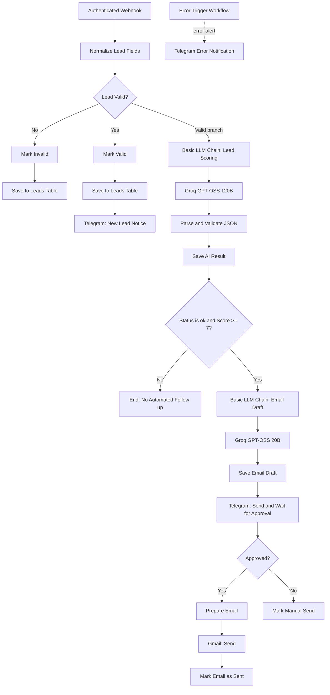

# AI-Powered Dental Lead Intake & Scoring Automation

An n8n workflow project that receives dental-clinic inquiries, validates submissions, uses LLMs to summarize and prioritize leads, and prepares follow-up emails for **human approval before sending**.

> **Project status:** Prototype / portfolio demonstration. It uses synthetic test data and is not a production-ready patient-management or clinical system.

## Overview

A dental clinic may receive many website inquiries with different levels of booking intent. This workflow helps organize those submissions by:

1. Receiving a lead through an authenticated webhook.
2. Normalizing and validating the submitted fields.
3. Storing valid and invalid submissions.
4. Asking an LLM to summarize, score, and categorize each valid lead.
5. Validating the LLM response and retaining malformed output for review.
6. Generating an email draft for higher-priority leads.
7. Asking a human reviewer to approve sending through Telegram.
8. Sending through Gmail **only after an explicit approval** and recording the result.

The workflow does not make clinical decisions. Its score is a heuristic estimate of booking readiness, not a medical assessment.

## Architecture



The test-form and evaluation workflows are supporting tools. They submit test payloads to the main workflow; they do not replace its production webhook.

## Main Workflows

| File | Purpose |
|---|---|
| `workflows/01-main-ai-workflow.json` | Main lead intake, AI qualification, email drafting, Telegram approval, and approved Gmail sending. |
| `workflows/02-error-workflow.json` | Receives unhandled workflow errors and sends an alert to Telegram. |
| `workflows/03-test-form-workflow.json` | Provides a test form that submits a lead to the main webhook. |
| `workflows/04-evaluation-workflow.json` | Sends the 10 synthetic test leads sequentially, with an 8-second interval, for repeatable evaluation. |

All exported workflows are inactive and have credential references removed. See [Setup](#setup) before importing or running them.

## Main Workflow Details

### 1. Lead intake and validation

- `Webhook - Receive Lead` accepts `POST` requests on the path `lead-ai` and uses Header Auth.
- `Edit Fields - Clean Data` trims text fields, lowercases email addresses, strips non-digits from phone numbers, and adds a timestamp.
- `IF - Is Lead Valid?` applies the prototype's basic validation: non-empty name, email containing `@`, and at least 7 phone digits.
- Valid and invalid leads are stored in the `Leads` Data Table. Valid leads also produce an initial Telegram notification.

This is basic input validation only. It does not verify that an email address or phone number belongs to the person submitting the form.

### 2. AI lead qualification

The first Basic LLM Chain sends only the lead's name, requested service, and message to Groq. It asks for a JSON object containing:

- `summary`: one or two sentences.
- `score`: integer from 1 to 10.
- `category`: `hot`, `warm`, or `cold`.
- `reason`: one short sentence.

A Code node parses and validates the response. It tolerates Markdown code fences and attempts to extract a JSON object from surrounding text. Valid results receive `ai_status: ok`. Missing, malformed, or out-of-range values are retained with `ai_status: needs_review`, plus `ai_raw` and `ai_error`; the parsing code does not throw for these response-validation failures.

### 3. Prioritization and email draft

All AI results are saved in `AI_Lead_Scoring`. Only items with `ai_status = ok` and `score >= 7` continue to email drafting. The second Basic LLM Chain produces a concise English follow-up draft, using only supplied facts and avoiding invented appointment availability, prices, or treatment outcomes.

### 4. Human approval and email sending

The draft and lead summary are sent to Telegram using `Send and Wait for Response` with in-chat approval buttons. Each incoming lead starts its own workflow execution; an execution waiting for a review does not pause the whole workflow for other leads.

- **Approve:** the workflow prepares the subject/body, sends the email through Gmail, then records `email_status = sent` and `email_sent_at`.
- **Send manually:** the workflow records `email_status = manual_send`; it does not send the email.

There is no automatic email send before human approval. The workflow records the reviewer ID/username and decision time when the Telegram response provides those fields.

## Model Selection by Task

The project uses two Groq-hosted models rather than applying the same largest model to every LLM task:

| Task | Model | Reason for selection |
|---|---|---|
| Lead qualification, scoring, and categorization | `openai/gpt-oss-120b` | The more reasoning-intensive task: interpret the inquiry, estimate booking readiness, and keep score/category consistent. |
| Follow-up email drafting | `openai/gpt-oss-20b` | A narrower text-generation task that uses an already prepared summary and lead fields. A smaller model is a better fit to test for lower inference cost and latency. |

This is a task-based model-selection decision intended to balance task complexity, output quality, speed, and potential token cost. It is not a claim that the smaller model is always sufficient; its draft quality should be checked against the project's requirements. Provider pricing, rate limits, and model availability can change.

## Why the Main Workflow Does Not Use Sub-workflows

Although the main workflow has grown, it currently represents one cohesive lead lifecycle: receive one lead, validate it, qualify it, optionally draft a follow-up, wait for a human decision, and then either send or stop. The stages share the same execution context and refer to data produced by earlier nodes. In particular, Telegram's `Send and Wait for Response` pauses and resumes the same lead execution, preserving the context needed for the approval decision and subsequent Gmail/Data Table updates.

For this prototype, splitting these stages into child workflows would add workflow-to-workflow data passing, caller/return handling, extra configuration, and more places to trace during debugging, without yet providing meaningful reuse across multiple parent workflows. Instead, the workflow is organized with named Canvas Groups and Sticky Notes so its responsibilities remain visible.

This is a scope-specific trade-off, not a general rule against sub-workflows. If the same qualification or notification logic is reused by multiple workflows, or if independent ownership, scaling, or deployment becomes necessary, extracting that reusable section into a sub-workflow would be appropriate.

## Data Tables

Create the following n8n Data Tables before running the imported main workflow.

### `Leads`

| Column | Type |
|---|---|
| `created_at` | String |
| `name` | String |
| `email` | String |
| `phone` | String |
| `service` | String |
| `message` | String |
| `status` | String |
| `reason` | String |

### `AI_Lead_Scoring`

| Column | Type |
|---|---|
| `created_at` | String |
| `name` | String |
| `email` | String |
| `phone` | String |
| `service` | String |
| `message` | String |
| `ai_status` | String |
| `summary` | String |
| `score` | Number |
| `category` | String |
| `reason` | String |
| `ai_raw` | String |
| `ai_error` | String |
| `email_draft` | String |
| `email_status` | String |
| `approved_by_id` | String |
| `approved_by_username` | String |
| `approved_at` | String |
| `email_sent_at` | String |

The n8n Data Table also manages its own row metadata (for example, row ID and timestamps); do not create duplicate system columns unless your n8n version explicitly requires them.

## Evaluation

The scoring prompt was evaluated on the same 10 fictional dental-clinic leads generated with ChatGPT. Expected categories and score ranges were defined in advance and were kept out of the payload sent to the model.

| Metric | Prompt V1 | Prompt V2 |
|---|---:|---:|
| Category agreement | 10/10 (100%) | 10/10 (100%) |
| Score within expected range | 8/10 (80%) | 10/10 (100%) |
| `needs_review` responses | 0 | 0 |
| Critical Hot → Cold errors | 0 | 0 |

V2 clarified category definitions, provided a score guide for each category, and added tie-break/scoring consistency rules. The JSON-only output schema was unchanged. Per-lead results are in [`docs/evaluation-results.json`](docs/evaluation-results.json), with a readable summary in [`docs/evaluation-results.md`](docs/evaluation-results.md); the two system prompts are in [`prompts/`](prompts/).

**Evaluation limitation:** This is a small, synthetic, ChatGPT-generated test set with predefined expected labels and score ranges. The results measure agreement with that test set only; they do not establish real-world accuracy or guarantee performance on actual clinic leads. The evaluation should be repeated with representative, consented, appropriately protected data before real-world use.

## Setup

1. Run a compatible self-hosted n8n instance. These exports were produced from n8n `2.45.4`; node behavior and parameters may differ across versions.
2. Import the four JSON files from `workflows/`. Keep the imported workflows inactive until setup and checks are complete.
3. Create the `Leads` and `AI_Lead_Scoring` Data Tables using the schemas above.
4. Create and select your own credentials in the relevant nodes:
   - Header Auth for the main webhook and HTTP Request helper workflows.
   - Groq API for both Groq Chat Model nodes.
   - Telegram API for notification, approval, and error-alert nodes.
   - Gmail OAuth2 for `Gmail - Send Approved Email`.
5. Replace `YOUR_TELEGRAM_CHAT_ID` with your own Telegram destination in the Telegram nodes.
6. In both helper HTTP Request workflows, replace `https://YOUR_N8N_DOMAIN/webhook/lead-ai` with the Production URL shown by your own main Webhook node. Select your own Header Auth credential. Do not add literal secrets to the workflow JSON.
7. Assign the imported `Lead Intake - Error Workflow (AI)` as the Error Workflow in the main workflow's Settings. The exported main workflow intentionally does not retain an instance-specific error-workflow ID.
8. Check that the Telegram approval node is configured for in-chat approval, and restrict who can approve where your deployment requires it. Make sure the n8n public HTTPS webhook URL is configured correctly if Telegram approval callbacks need to reach your self-hosted instance.
9. Test with fictional data first. Only activate/publish the main workflow after verifying credentials, tables, webhook authentication, Telegram approval, and Gmail behavior.

The test-form and evaluation workflows are helper workflows; they can remain inactive and be run manually as needed.

## Security Notes

- The JSON exports intentionally contain no credential references, API keys, OAuth secrets, webhook secrets, personal Telegram chat IDs, or personal ngrok domains.
- The `.env` file, local n8n configuration, credential exports, and real customer data must never be committed.
- Use synthetic data for demos. Do not send real patient/customer information to third-party AI services unless you have appropriate authorization, privacy safeguards, and provider terms in place.
- Human approval is a control in this prototype, but reviewers should still verify the recipient and the content before approving an email.

## Repository Structure

```text
n8n-ai-lead-scoring-automation/
├── README.md
├── .gitignore
├── workflows/
│   ├── 01-main-ai-workflow.json
│   ├── 02-error-workflow.json
│   ├── 03-test-form-workflow.json
│   └── 04-evaluation-workflow.json
├── prompts/
│   ├── prompt_v1.txt
│   └── prompt_v2.txt
├── test-data/
│   └── test_leads.json
├── docs/
│   ├── evaluation-results.json
│   └── evaluation-results.md
└── screenshots/
    ├── .gitkeep
    ├── 01-main-workflow-overview.png
    ├── 02-ai-scoring-and-email-draft.png
    ├── 03-telegram-human-approval.png
    ├── 04-ai-lead-scoring-data.png
    ├── 05-approved-email-execution.png
    └── 06-prompt-evaluation-results.png
```

## Demo

The six workflow and evaluation screenshots are available in [`screenshots/`](screenshots/). A walkthrough video will be added after the final recording and review.